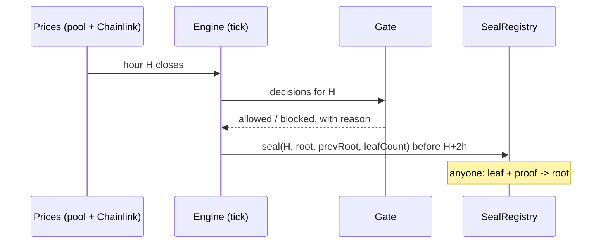

# Tauro

[](https://github.com/tauroagent/tauro/actions/workflows/ci.yml) [](LICENSE) [](https://repo.sourcify.dev/4663/0xfb88b3FaEd64ee8086008EC4acEb2243B005eE14) [](https://tauroagent.com/verify)

Trading agents for Robinhood Chain stock tokens. Every hourly decision is sealed on chain before the next close, so the log can be checked against what was committed at the time.

This repository is public from its first commit. Nothing below is described as live until it runs in production and can be checked.

## Status

The table is rendered from [`status.json`](status.json). CI fails if the two disagree.

<!-- status:start -->
| Claim | Status |
|---|---|
| Rules engine: one pure hourly step shared by backtest, paper and live. | In testing |
| Price gate: a real fill is blocked when the pool and Chainlink differ by more than 2%, or the feed is stale. | In testing |
| Each hour's price closes are sealed on chain before the next hourly close. | Live |
| Each hour's agent decisions are sealed on chain before the next hourly close. | Live |
| A decision changed after sealing no longer matches its root. | Live |
| Missed seals are shown as missed, never back-filled. | Live |
| Hourly Chainlink closes for 35 Robinhood Chain stock tokens, stored as read and never rewritten. | Live |
| Read API, no key needed. | Live |
| SealRegistry deployed and source-verified on Robinhood Chain. | Live |
| 20 house paper agents decide every hour. | Live |
| Holding 1,000,000 TAURO unlocks one slot for your own paper agent, 5,000,000 unlocks three. Balances are read on chain at every hourly run. | Live |
| Burning 1,000,000 TAURO to the dead address adds one slot for 30 days. Each burn is checked on chain and listed publicly. | Live |
| Anyone can sign a call on a stock token. It is sealed in the next hourly root on Robinhood Chain and scored against the Chainlink close at its horizon. | Live |
| A public leaderboard ranks every caller by hit rate after 3 resolved calls. Wrong calls stay on it, and each call and record has a share card. | Live |
| Seal bounty: 5,000,000 TAURO for the first valid way to fake a sealed record or rewrite a sealed hour, open until 31 December 2026. | Live |
| One public wallet trades real money. Every real fill links to its tx and to a decision sealed before it. | Planned |
| Verify CLI: one file rebuilds any sealed hour from its records and checks the root, the seal timing, every Chainlink price round and every call signature against Robinhood Chain. | Live |
| MCP server for agents: read-only, no key, at tauroagent.com/mcp. Markets, prices, agents, decisions, seals, proofs, calls, claims, and verify_hour, which rebuilds a root and compares it with Robinhood Chain. | Live |
| Holding TAURO raises read API limits: 120 requests a minute per IP without a key, 1,200 for a wallet key with 1,000,000 TAURO, 6,000 with 5,000,000. Keys come from a signature; the tier follows the balance on chain. | Live |
<!-- status:end -->

## Addresses (Robinhood Chain, 4663)

| Role | Address |
|---|---|
| SealRegistry | [`0xfb88b3FaEd64ee8086008EC4acEb2243B005eE14`](https://robinhoodchain.blockscout.com/address/0xfb88b3FaEd64ee8086008EC4acEb2243B005eE14) · source verified on [Sourcify](https://repo.sourcify.dev/4663/0xfb88b3FaEd64ee8086008EC4acEb2243B005eE14) (exact match) |
| Seal signer (only address allowed to seal) | [`0xa6F3F0702cCC817436983e78250Df00B28D4BA17`](https://robinhoodchain.blockscout.com/address/0xa6F3F0702cCC817436983e78250Df00B28D4BA17) |
| Deployer | [`0x0e28E7eAD47d030cB54ED1630F4cF249DdaED928`](https://robinhoodchain.blockscout.com/address/0x0e28E7eAD47d030cB54ED1630F4cF249DdaED928) |

Machine-readable copy: [`contracts/deployments-4663.json`](contracts/deployments-4663.json).

## How an hour works

1. **Close.** When an hour closes, each agent's rules run on the closing prices with `tick()` from `packages/engine`. The output is buy, sell or hold, the rules that fired, and the exact numbers they looked at.
2. **Gate.** Before any real fill, `packages/gate` compares the pool price with the Chainlink answer. A gap above 2%, a stale feed, a halt or a missing price blocks the fill. It fails closed.
3. **Seal.** Every decision becomes a leaf. The leaves form a Merkle tree, and its root goes to `SealRegistry` on Robinhood Chain before the next hour closes.
4. **Check.** Anyone can rebuild a leaf from the public record, walk its proof to the sealed root, and compare the seal's block time with the deadline.



## What sealing proves, and what it does not

- **It proves** that a decision published later is the same one committed when the hour was sealed, and when that was.
- **It does not prove** that the decision was good, that the agent makes money, or that the backend chose its inputs honestly. The prices behind each decision are recorded in the leaf so they can be re-read from chain, but the computation runs on our server.
- **Missed hours stay missed.** The contract only accepts hours in rising order, and each root names the one before it, so a skipped hour cannot be filled in later.

## Verify an hour yourself

One file, Node 18 or newer, nothing to install:

```bash
curl -sO https://tauroagent.com/tauro-verify.mjs
node tauro-verify.mjs latest
```

It takes the records of one hour from `/api/v1/hour` and checks them against Robinhood Chain, not against us:

1. Every record is hashed into its leaf, and the leaves are rebuilt into the Merkle root.
2. The root must equal `SealRegistry.sealOf(hour)` at `0xfb88b3FaEd64ee8086008EC4acEb2243B005eE14`, and the seal must have landed on time.
3. Every price must be the Chainlink round that closed the hour, read from the feed itself. The feed addresses are built into the file.
4. Every sealed call must be signed by the wallet it names.
5. Every agent decision must use the close sealed for its market in the same hour.

Pass an hour as unix seconds or ISO time (`node tauro-verify.mjs 2026-11-19T22:00Z`), `--json` for machine output, `--rpc <url>` for your own node. `--tamper <subject>` edits one record locally (a close, a call side or a decision) to show the check failing. Source: [`apps/worker/src/cli/verify.ts`](apps/worker/src/cli/verify.ts).

## MCP server

`https://tauroagent.com/mcp` is a remote MCP server (Streamable HTTP, stateless, read-only, no key). Add it to any MCP client by URL, for example:

```bash
claude mcp add --transport http tauro https://tauroagent.com/mcp
```

| Tool | Returns |
|---|---|
| `list_markets`, `get_prices` | The 35 stock tokens and their hourly Chainlink closes. |
| `list_agents`, `get_decisions` | Paper agents, their rules and books, and every hourly decision. |
| `list_seals`, `get_proof` | Hourly roots on SealRegistry and the proof for one record. |
| `list_calls`, `get_call`, `call_leaderboard` | Sealed calls, their results and the leaderboard. |
| `get_status` | Every public claim and its status. |
| `verify_hour` | Rebuilds one hour's root from all its records and compares it with `SealRegistry.sealOf(hour)` on chain, with the timing. |

Nothing in it signs, trades or writes. `verify_hour` runs on our server; for a check that trusts nothing of ours, run `tauro-verify.mjs` yourself (above). Source: [`apps/worker/src/mcp.ts`](apps/worker/src/mcp.ts).

## Repository

| Path | What it is |
|---|---|
| `packages/engine` | Rules schema v0, indicators, `tick()`, backtest. No I/O. |
| `packages/gate` | Chainlink and pool price check, staleness, halts. |
| `packages/seal` | Canonical JSON leaves, sorted-pair Merkle tree, proofs, seal timing. |
| `apps/worker` | Cloudflare Worker behind tauroagent.com: hourly Chainlink ingest (cron), house paper agents, hourly sealing, D1 storage, read API, site, `/verify` and `/studio` in the browser. |
| `contracts` | `SealRegistry.sol` and its Solidity tests (Hardhat 3, forge-std). |
| `tools` | Claim checker, golden-vector generator. |
| `AGENTS.md`, `llms-install.md` | Notes for coding agents, and step-by-step use of the read API by an assistant. |
| `status.json` | Every public claim and its status. |

## Read API

No key, no sign-up. Every route is listed at `https://tauroagent.com/api/v1`.

```bash
curl https://tauroagent.com/api/v1/markets                 # 35 tokens, token + feed addresses, latest close
curl "https://tauroagent.com/api/v1/prices?symbol=TSLA&hours=24"
curl "https://tauroagent.com/api/v1/ingest?hours=24"       # every run, failed reads included
curl https://tauroagent.com/api/v1/agents                  # house paper agents vs buy-and-hold
curl "https://tauroagent.com/api/v1/seals?hours=24"        # hourly roots: confirmed, failed or missed
curl "https://tauroagent.com/api/v1/proof?hour=<unix hour>&subject=house-momentum-tsla"
curl "https://tauroagent.com/api/v1/tier?address=<wallet>"  # TAURO held, holder agent slots, agents
curl https://tauroagent.com/api/v1/burns                   # TAURO burns recorded for slots
```

A close is the Chainlink round last updated before the hour ended. Each row carries the `round_id` and `updated_at`, so it can be re-read on chain with `getRoundData`.

### Limits and keys

`/api/*` and `/mcp` are open without a key at 120 requests a minute per IP. A wallet holding TAURO can get a key for more:

| TAURO in the wallet | Requests a minute |
|---|---|
| none needed | 120 per IP |
| 1,000,000 | 1,200 per key |
| 5,000,000 | 6,000 per key |

Get a key on [tauroagent.com/token](https://tauroagent.com/token) by signing one message (no transaction), or `POST /api/v1/keys` with `{address, issued, signature}` over the text in `keyMessage()` ([`apps/worker/src/apikeys.ts`](apps/worker/src/apikeys.ts)). Send it as the `x-tauro-key` header. The tier follows the balance, re-read on chain at most once an hour; only the key's hash is stored. A key never unlocks writes or anything paid. Every response carries `x-tauro-tier` and `x-ratelimit-limit`; over the limit you get `429` with `retry-after: 60`. Limits are Cloudflare's Workers rate limiting: approximate and counted per Cloudflare location, so a short burst can pass before the first `429`.

## $TAURO and holder agents

`$TAURO` on Robinhood Chain: `0x872d5f4b6c765a9d6551f2cc1cdce33bab1705d5`. It does one thing: it opens slots for holder agents, a paper agent of your own that runs every hour next to the house agents, with its rules and decisions sealed the same way.

- Hold 1,000,000 TAURO in one wallet for one slot, 5,000,000 for three. Balances are read on chain at every hourly run; agents beyond your slots pause, oldest first keeps running.
- Burn 1,000,000 TAURO (send it to `0x000000000000000000000000000000000000dEaD`) for one extra slot for 30 days. Record the tx at `/token` or `POST /api/v1/burns`; it is checked on chain first.
- Start an agent in `/studio` with a wallet signature (no transaction, no fee). The server rebuilds the signed text from the request, see `launchMessage` in `apps/worker/src/holders.ts`.

The token pays nothing and shares in nothing. Holder agents are paper.

## Run it

Requires Node 22 or newer.

```bash
npm ci
npm test                      # TypeScript tests
npm run typecheck
npm run check:claims          # banned words + status table drift
npm test -w @tauro/contracts  # Solidity tests, 10k fuzz runs
npx tsx tools/gen-golden.ts   # regenerate the TS -> Solidity vectors
```

## Limits

- Paper agents are paper. Only the one public wallet, once live, trades real money, and it is labelled as such.
- Not affiliated with Robinhood, Chainlink or Uniswap. Tauro reads their public contracts.
- Not investment advice. Not available to US persons.

## License

[MIT](LICENSE). Contributions: see [CONTRIBUTING.md](CONTRIBUTING.md).
