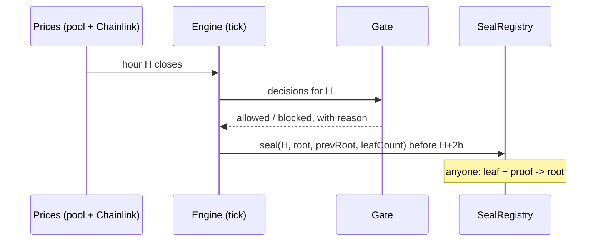

# Tauro

Trading agents for Robinhood Chain stock tokens. Every hourly decision is sealed on chain before the next close, so the log can be checked against what was committed at the time.

This repository is public from its first commit. Nothing below is described as live until it runs in production and can be checked.

## Status

The table is rendered from [`status.json`](status.json). CI fails if the two disagree.

<!-- status:start -->
| Claim | Status |
|---|---|
| Rules engine: one pure hourly step shared by backtest, paper and live. | In testing |
| Price gate: a real fill is blocked when the pool and Chainlink differ by more than 2%, or the feed is stale. | In testing |
| Each hour's decisions are sealed on chain before the next hourly close. | In testing |
| A decision changed after sealing no longer matches its root. | In testing |
| Missed seals are shown as missed, never back-filled. | In testing |
| Hourly Chainlink closes for 35 Robinhood Chain stock tokens, stored as read and never rewritten. | Live |
| Read API, no key needed. | Live |
| SealRegistry deployed and source-verified on Robinhood Chain. | Live |
| House paper agents decide every hour. | Planned |
| One public wallet trades real money. Every real fill links to its tx and to a decision sealed before it. | Planned |
| Verify CLI: recompute any sealed hour from public data. | Planned |
| MCP server for agents. | Planned |
<!-- status:end -->

## Addresses (Robinhood Chain, 4663)

| Role | Address |
|---|---|
| SealRegistry | [`0xfb88b3FaEd64ee8086008EC4acEb2243B005eE14`](https://robinhoodchain.blockscout.com/address/0xfb88b3FaEd64ee8086008EC4acEb2243B005eE14) · source verified on [Sourcify](https://repo.sourcify.dev/4663/0xfb88b3FaEd64ee8086008EC4acEb2243B005eE14) (exact match) |
| Seal signer (only address allowed to seal) | [`0xa6F3F0702cCC817436983e78250Df00B28D4BA17`](https://robinhoodchain.blockscout.com/address/0xa6F3F0702cCC817436983e78250Df00B28D4BA17) |
| Deployer | [`0x0e28E7eAD47d030cB54ED1630F4cF249DdaED928`](https://robinhoodchain.blockscout.com/address/0x0e28E7eAD47d030cB54ED1630F4cF249DdaED928) |

Machine-readable copy: [`contracts/deployments-4663.json`](contracts/deployments-4663.json).

## How an hour works

1. **Close.** When an hour closes, each agent's rules run on the closing prices with `tick()` from `packages/engine`. The output is buy, sell or hold, the rules that fired, and the exact numbers they looked at.
2. **Gate.** Before any real fill, `packages/gate` compares the pool price with the Chainlink answer. A gap above 2%, a stale feed, a halt or a missing price blocks the fill. It fails closed.
3. **Seal.** Every decision becomes a leaf. The leaves form a Merkle tree, and its root goes to `SealRegistry` on Robinhood Chain before the next hour closes.
4. **Check.** Anyone can rebuild a leaf from the public record, walk its proof to the sealed root, and compare the seal's block time with the deadline.



## What sealing proves, and what it does not

- **It proves** that a decision published later is the same one committed when the hour was sealed, and when that was.
- **It does not prove** that the decision was good, that the agent makes money, or that the backend chose its inputs honestly. The prices behind each decision are recorded in the leaf so they can be re-read from chain, but the computation runs on our server.
- **Missed hours stay missed.** The contract only accepts hours in rising order, and each root names the one before it, so a skipped hour cannot be filled in later.

## Repository

| Path | What it is |
|---|---|
| `packages/engine` | Rules schema v0, indicators, `tick()`, backtest. No I/O. |
| `packages/gate` | Chainlink and pool price check, staleness, halts. |
| `packages/seal` | Canonical JSON leaves, sorted-pair Merkle tree, proofs, seal timing. |
| `apps/worker` | Cloudflare Worker behind tauroagent.com: hourly Chainlink ingest (cron), D1 storage, read API, home page. |
| `contracts` | `SealRegistry.sol` and its Solidity tests (Hardhat 3, forge-std). |
| `tools` | Claim checker, golden-vector generator. |
| `status.json` | Every public claim and its status. |

## Read API

No key, no sign-up. Every route is listed at `https://tauroagent.com/api/v1`.

```bash
curl https://tauroagent.com/api/v1/markets                 # 35 tokens, token + feed addresses, latest close
curl "https://tauroagent.com/api/v1/prices?symbol=TSLA&hours=24"
curl "https://tauroagent.com/api/v1/ingest?hours=24"       # every run, failed reads included
```

A close is the Chainlink round last updated before the hour ended. Each row carries the `round_id` and `updated_at`, so it can be re-read on chain with `getRoundData`.

## Run it

Requires Node 22 or newer.

```bash
npm ci
npm test                      # TypeScript tests
npm run typecheck
npm run check:claims          # banned words + status table drift
npm test -w @tauro/contracts  # Solidity tests, 10k fuzz runs
npx tsx tools/gen-golden.ts   # regenerate the TS -> Solidity vectors
```

## Limits

- Paper agents are paper. Only the one public wallet, once live, trades real money, and it is labelled as such.
- Not affiliated with Robinhood, Chainlink or Uniswap. Tauro reads their public contracts.
- Not investment advice. Not available to US persons.

## License

[MIT](LICENSE). Built with AI assistance; see [CONTRIBUTING.md](CONTRIBUTING.md).
